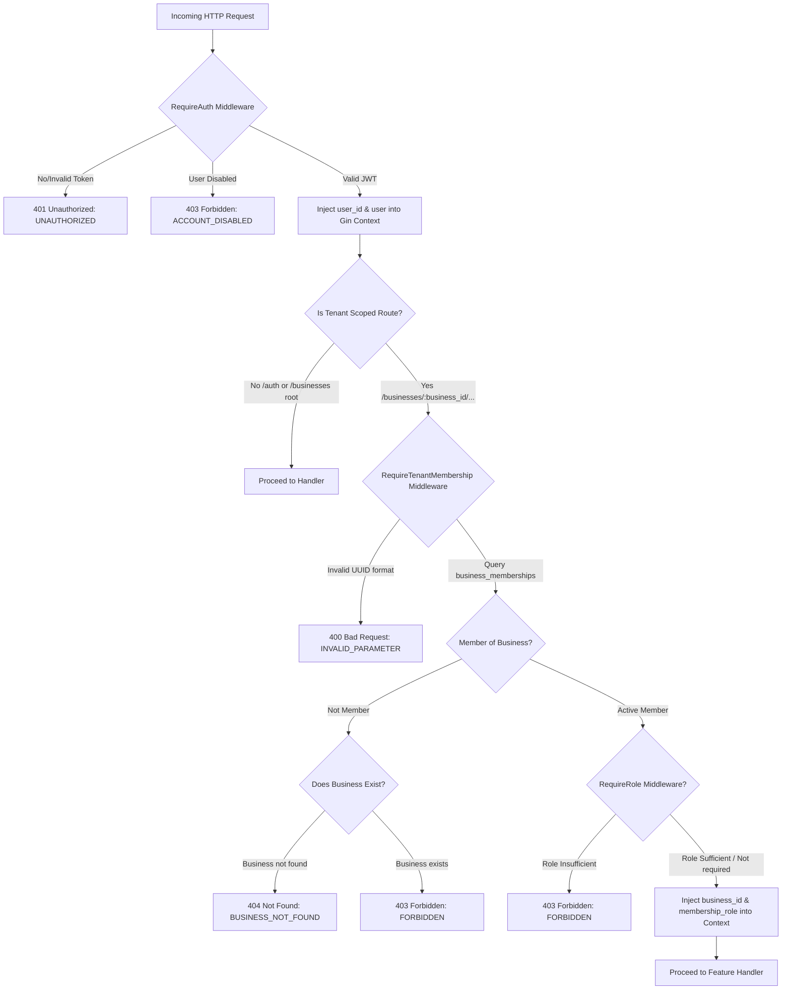

# API Contract: Authentication, Business Management & Tenant Middleware

> **Status:** Accepted Contract v1.0  
> **Source Documents:** `project-map/prd.md` (§5.1, §8.1), `project-map/trd.md` (§4, §5 TD-04, TD-05, TD-06, TD-11, TD-13, §9, §10), `contracts/erd.md` (§2, §6, §7), `contracts/ui-auth-business.md`  
> **Target Audience:** Frontend Engineer (`frontend`), Backend & AI Engineer (`backend-ai`), QA Engineer (`tester`)  
> **Base Prefix:** `/api/v1`

---

## 1. Global API Conventions

Sesuai dengan keputusan arsitektur **TRD TD-13** dan pedoman `SOUL.md`:

1. **Format Payload & Header**:
   - Protokol: HTTPS.
   - Header Permintaan Standar:
     - `Content-Type: application/json` (untuk semua permintaan bertubuh/body).
     - `Accept: application/json`.
     - `Authorization: Bearer <access_token>` (wajib pada endpoint terproteksi).
     - `X-Request-ID: <uuid>` (opsional dari klien, jika kosong akan digenerate otomatis oleh server dan selalu dikembalikan pada respons header).
   - Penamaan properti JSON menggunakan **`snake_case`**.
   - Standar Waktu: ISO 8601 / RFC 3339 UTC (`YYYY-MM-DDTHH:mm:ssZ`).
   - Format Tanggal: Kalender bisnis `YYYY-MM-DD`.
   - Representasi Nilai Uang: String desimal untuk presisi tinggi (contoh: `"150000.00"`).

2. **Skema Standar Respons Galat (Error Schema)**:
   Semua respon kegagalan (HTTP status 4xx dan 5xx) memiliki format seragam:
   ```json
   {
     "error": {
       "code": "STRING_ERROR_CODE",
       "message": "Pesan ramah pengguna dalam Bahasa Indonesia",
       "details": [
         {
           "field": "nama_kolom",
           "message": "Pesan rincian kesalahan spesifik kolom"
         }
       ]
     }
   }
   ```
   - `error.code`: Kode stabil yang dapat diparsing mesin dalam huruf kapital bahasa Inggris (contoh: `INVALID_CREDENTIALS`, `FORBIDDEN`, `VALIDATION_ERROR`).
   - `error.message`: Pesan berbahasa Indonesia yang aman ditampilkan langsung kepada pengguna akhir (bebas dari *stack trace*, SQL query, maupun kebocoran internal).
   - `error.details`: Bersifat opsional, berupa array objek validasi jika terdapat kesalahan input spesifik pada kolom formulir.

3. **Pemisahan DTO & Keamanan Objek**:
   - Handler API tidak pernah mengikat (*bind*) langsung ke entitas GORM atau mengembalikan model database secara telanjang.
   - Kolom rahasia seperti `password_hash`, salt argon2id, atau hash refresh token **dilarang keras** bocor ke dalam JSON respons.

---

## 2. Authentication Flow & Security Model (TD-06)

Alur autentikasi dan otorisasi mengadopsi standar **TRD TD-06**:

1. **Kata Sandi**:
   - Algoritma hashing: **argon2id** (`golang.org/x/crypto/argon2`).
   - Dilarang menyimpan atau mencatat plaintext kata sandi ke dalam log aplikasi.

2. **Access Token (JWT)**:
   - Format: JSON Web Token (JWT).
   - Algoritma terikat (*pinned algorithm*): `HS256` dengan kunci rahasia berkekuatan tinggi dari konfigurasi lingkungan (`JWT_SECRET`).
   - Masa berlaku (*TTL*): **15 menit** (`exp = now + 900s`).
   - Lokasi penyimpanan di klien: Memori aplikasi SPA (React context/state). **Tidak disimpan di localStorage atau sessionStorage** untuk mencegah serangan XSS.
   - Klaim JWT standar:
     - `sub`: User ID (`UUIDv7`)
     - `email`: Email pengguna
     - `status`: Status akun pengguna (`active`)
     - `iss`: `"teman-umkm-api"`
     - `aud`: `"teman-umkm-app"`
     - `exp`: Epoch timestamp kedaluwarsa
     - `iat`: Epoch timestamp penerbitan

3. **Refresh Token & Family Rotation**:
   - Token acak kriptografis (32-byte secure random string, URL-safe base64).
   - Database hanya menyimpan hash token (`token_hash`) pada tabel `refresh_tokens`. Raw token tidak pernah disimpan di database.
   - Masa berlaku (*TTL*): **14 hari** (`expires_at = now + 1209600s`).
   - Pengiriman ke klien via **HTTP Cookie**:
     - `Name`: `refresh_token`
     - `HttpOnly`: `true` (tidak dapat diakses oleh JavaScript frontend)
     - `Secure`: `true` (hanya dikirim melalui HTTPS; mode lokal dapat `false` hanya jika via localhost murni)
     - `SameSite`: `Lax`
     - `Path`: `/api/v1/auth`
     - `Max-Age`: `1209600` (14 hari)
   - **Rotasi Setiap Penggunaan & Deteksi Penggunaan Ulang (Reuse Detection)**:
     - Setiap pemanggilan endpoint `POST /api/v1/auth/refresh` akan menerbitkan refresh token baru dan membatalkan token yang lama (`used_at = now()`).
     - Jika sebuah refresh token yang sudah pernah digunakan (`used_at IS NOT NULL`) dikirimkan kembali ke server, sistem mendeteksi indikasi kompromi/pencurian sesi. Server akan seketika mencabut seluruh keluarga token (`family_id`) dan mengembalikan galat `401 Unauthorized` dengan kode `INVALID_REFRESH_TOKEN`.
   - **Validasi Header `Origin`**:
     - Endpoint berbasis cookie (`/refresh` dan `/logout`) memeriksa header `Origin` terhadap allowlist domain frontend yang diizinkan untuk memitigasi serangan CSRF.

4. **Generic Auth Error (Anti Akun-Enumerasi)**:
   - Respon terhadap email tidak ditemukan dan kata sandi salah dibuat **identik**:
     - Status: `401 Unauthorized`
     - Kode: `INVALID_CREDENTIALS`
     - Pesan: `"Email atau password salah."`
   - Server tidak pernah mengonfirmasi apakah suatu alamat email terdaftar atau tidak pada alur login.

---

## 3. Tenant Isolation & Middleware Architecture (TD-05)

Sesuai **TRD TD-05**, isolasi multi-tenant dijamin melalui 4 lapis perlindungan:
1. Jalur rute terlingkup (*scoped route path*): `/api/v1/businesses/{business_id}/...`.
2. Middleware verifikasi keanggotaan tenant (`TenantMiddleware`).
3. Seluruh metode repositori backend mewajibkan parameter `business_id`.
4. Composite Foreign Keys pada tingkat PostgreSQL (`contracts/erd.md` §7).

### 3.1. Alur Eksekusi Middleware Pipeline



### 3.2. Spesifikasi Tenant Middleware

- **Nama Middleware**: `RequireTenantMembership()`
- **Parameter Ekstraksi**: `:business_id` dari parameter URL rute Gin (`c.Param("business_id")`).
- **Logika Otorisasi**:
  1. Validasi sintaksis format string `business_id` sebagai `UUIDv7`. Bila invalid, kembalikan `400 Bad Request` (`code: INVALID_PARAMETER`).
  2. Eksekusi query relasi:
     `SELECT role FROM business_memberships WHERE business_id = :business_id AND user_id = :user_id`
  3. Evaluasi hasil query:
     - Jika ditemukan relasi aktif:
       - Tetapkan variabel konteks request:
         - `c.Set("business_id", parsedBusinessID)`
         - `c.Set("membership_role", role)` (`"owner"` atau `"staff"`)
       - Teruskan request ke handler berikutnya (`c.Next()`).
     - Jika tidak ditemukan relasi keanggotaan:
       - Lakukan pengecekan eksistensi entitas: `SELECT 1 FROM businesses WHERE id = :business_id`.
       - Jika bisnis tidak ada di database: kembalikan `404 Not Found` dengan kode `BUSINESS_NOT_FOUND`.
       - Jika bisnis ada tetapi pengguna bukan anggota: kembalikan `403 Forbidden` dengan kode `FORBIDDEN` (`"Anda tidak memiliki akses ke bisnis ini."`).
- **Nama Role Guard Middleware**: `RequireBusinessRole(allowedRoles ...string)`
  - Memverifikasi apakah nilai `membership_role` dalam konteks termasuk dalam salah satu `allowedRoles`.
  - Jika pengguna memiliki role `staff` pada rute yang membutuhkan role `owner` (misal pembaruan profil bisnis `PATCH /api/v1/businesses/{business_id}`), middleware menggagalkan request dengan status `403 Forbidden` dan pesan: `"Hanya pemilik usaha (owner) yang dapat memperbarui pengaturan profil bisnis."`.

---

## 4. Authentication Endpoints

### 4.1. Registrasi Akun Pengguna (`POST /api/v1/auth/register`)

Mendaftarkan akun pemilik usaha baru ke dalam sistem.

- **URL**: `/api/v1/auth/register`
- **Method**: `POST`
- **Autentikasi**: Publik (Tanpa header Authorization)
- **Rate Limit**: 5 permintaan per 15 menit per IP

#### Request Payload
```json
{
  "email": "budi.santoso@example.com",
  "password": "Password123",
  "display_name": "Budi Santoso"
}
```

#### Aturan Validasi Input
| Kolom | Tipe | Wajib | Aturan |
| :--- | :--- | :--- | :--- |
| `email` | String | Ya | Format email valid RFC 5322, panjang maksimal 255 karakter, dinormalisasi ke huruf kecil (*lowercased* & trimmed). |
| `password` | String | Ya | Minimal 8 karakter, maksimal 72 karakter (batas kapasitas bcrypt/argon2), wajib mengandung kombinasi huruf dan angka. |
| `display_name` | String | Ya | Minimal 2 karakter, maksimal 100 karakter, teks bersih (trimmed, non-empty). |

#### Responses

- **201 Created**
  - **Headers**:
    - `Content-Type: application/json`
    - `Set-Cookie: refresh_token=dGhpcy1pcy1hLXJhbmRvbS1zZWN1cmUtdG9rZW4...; Path=/api/v1/auth; HttpOnly; Secure; SameSite=Lax; Max-Age=1209600`
  - **Payload Body**:
    ```json
    {
      "user": {
        "id": "0192e4a1-8d2b-7c12-9842-123456789abc",
        "email": "budi.santoso@example.com",
        "display_name": "Budi Santoso",
        "status": "active",
        "created_at": "2026-10-18T07:15:00Z"
      },
      "access_token": "eyJhbGciOiJIUzI1NiIsInR5cCI6IkpXVCJ9.eyJzdWIiOiIwMTkyZTRhMS04ZDJiLTdjMTItOTg0Mi0xMjM0NTY3ODlhYmMiLCJlbWFpbCI6ImJ1ZGkuc2FudG9zb0BleGFtcGxlLmNvbSIsImV4cCI6MTczNDUyMTIwMH0...",
      "token_type": "Bearer",
      "expires_in": 900
    }
    ```

- **400 Bad Request** (`VALIDATION_ERROR`)
  ```json
  {
    "error": {
      "code": "VALIDATION_ERROR",
      "message": "Validasi input formulir pendaftaran gagal.",
      "details": [
        {
          "field": "password",
          "message": "Kata sandi minimal 8 karakter dan mengandung huruf serta angka."
        }
      ]
    }
  }
  ```

- **409 Conflict** (`EMAIL_ALREADY_EXISTS`)
  ```json
  {
    "error": {
      "code": "EMAIL_ALREADY_EXISTS",
      "message": "Email ini sudah terdaftar. Silakan gunakan email lain atau masuk ke akun Anda."
    }
  }
  ```

- **429 Too Many Requests** (`RATE_LIMIT_EXCEEDED`)
  ```json
  {
    "error": {
      "code": "RATE_LIMIT_EXCEEDED",
      "message": "Terlalu banyak permintaan registrasi. Silakan coba lagi setelah 15 menit."
    }
  }
  ```

---

### 4.2. Masuk / Login Pengguna (`POST /api/v1/auth/login`)

Mengautentikasi pengguna menggunakan email dan kata sandi. Mengembalikan JWT access token dan menyertakan daftar profil bisnis yang dimiliki oleh akun.

- **URL**: `/api/v1/auth/login`
- **Method**: `POST`
- **Autentikasi**: Publik (Tanpa header Authorization)
- **Rate Limit**: 10 permintaan per 15 menit per IP dan kombinasi email

#### Request Payload
```json
{
  "email": "budi.santoso@example.com",
  "password": "Password123"
}
```

#### Aturan Validasi Input
| Kolom | Tipe | Wajib | Aturan |
| :--- | :--- | :--- | :--- |
| `email` | String | Ya | Format email valid, dinormalisasi ke huruf kecil (*lowercased*). |
| `password` | String | Ya | Teks kata sandi tidak boleh kosong. |

#### Responses

- **200 OK**
  - **Headers**:
    - `Content-Type: application/json`
    - `Set-Cookie: refresh_token=eWV0LWFub3RoZXItc2VjdXJlLXRva2Vu...; Path=/api/v1/auth; HttpOnly; Secure; SameSite=Lax; Max-Age=1209600`
  - **Payload Body**:
    ```json
    {
      "user": {
        "id": "0192e4a1-8d2b-7c12-9842-123456789abc",
        "email": "budi.santoso@example.com",
        "display_name": "Budi Santoso",
        "status": "active",
        "last_login_at": "2026-10-18T07:20:00Z",
        "created_at": "2026-10-18T07:15:00Z"
      },
      "access_token": "eyJhbGciOiJIUzI1NiIsInR5cCI6IkpXVCJ9...",
      "token_type": "Bearer",
      "expires_in": 900,
      "businesses": [
        {
          "id": "0192e4a2-4a11-7f88-b715-987654321def",
          "name": "Kopi Seduh Santai",
          "business_type": "Kuliner & F&B",
          "currency": "IDR",
          "timezone": "Asia/Jakarta",
          "report_period_start_day": 1,
          "role": "owner"
        }
      ]
    }
    ```
    *Catatan Frontend*: Jika array `businesses` kosong (`[]`), frontend wajib mengarahkan pengguna ke halaman onboarding bisnis `/onboarding`.

- **400 Bad Request** (`VALIDATION_ERROR`)
  ```json
  {
    "error": {
      "code": "VALIDATION_ERROR",
      "message": "Email dan kata sandi wajib diisi.",
      "details": [
        {
          "field": "email",
          "message": "Format email tidak valid."
        }
      ]
    }
  }
  ```

- **401 Unauthorized** (`INVALID_CREDENTIALS`)
  *Security Note*: Respon identik diberikan jika email tidak ada di sistem ATAU kata sandi salah.
  ```json
  {
    "error": {
      "code": "INVALID_CREDENTIALS",
      "message": "Email atau password salah."
    }
  }
  ```

- **403 Forbidden** (`ACCOUNT_DISABLED`)
  ```json
  {
    "error": {
      "code": "ACCOUNT_DISABLED",
      "message": "Akun Anda telah dinonaktifkan. Silakan hubungi dukungan pelanggan."
    }
  }
  ```

- **429 Too Many Requests** (`RATE_LIMIT_EXCEEDED`)
  ```json
  {
    "error": {
      "code": "RATE_LIMIT_EXCEEDED",
      "message": "Terlalu banyak percobaan masuk yang gagal. Silakan coba kembali dalam 15 menit."
    }
  }
  ```

---

### 4.3. Perpanjangan Sesi Token (`POST /api/v1/auth/refresh`)

Menerbitkan JWT access token baru menggunakan httpOnly refresh token cookie. Menerapkan rotasi token keluarga (*token family rotation*) untuk mencegah replay attack.

- **URL**: `/api/v1/auth/refresh`
- **Method**: `POST`
- **Autentikasi**: Menggunakan Cookie `refresh_token`
- **Header Khusus**: Wajib menyertakan header `Origin` yang valid.
- **Rate Limit**: 10 permintaan per 15 menit per IP

#### Request Payload
Tubuh permintaan kosong (`{}` atau *empty body*). Nilai token dibaca langsung oleh server dari cookie HTTP `refresh_token`.

#### Responses

- **200 OK**
  - **Headers**:
    - `Content-Type: application/json`
    - `Set-Cookie: refresh_token=bmV3bHktcm90YXRlZC1zZWN1cmUtdG9rZW4...; Path=/api/v1/auth; HttpOnly; Secure; SameSite=Lax; Max-Age=1209600`
  - **Payload Body**:
    ```json
    {
      "access_token": "eyJhbGciOiJIUzI1NiIsInR5cCI6IkpXVCJ9.eyJzdWIiOiIwMTkyZTRhMS04ZDJiLTdjMTItOTg0Mi0xMjM0NTY3ODlhYmMiLCJleHAiOjE3MzQ1MjIwMDB9...",
      "token_type": "Bearer",
      "expires_in": 900
    }
    ```

- **401 Unauthorized** (`INVALID_REFRESH_TOKEN` / `REFRESH_TOKEN_EXPIRED`)
  - Jika cookie `refresh_token` tidak dikirimkan, kedaluwarsa, atau tidak cocok dengan database:
    ```json
    {
      "error": {
        "code": "INVALID_REFRESH_TOKEN",
        "message": "Sesi Anda telah berakhir. Silakan masuk kembali."
      }
    }
    ```
  - *Reuse Detection Triggered*: Jika token yang dikirim ternyata sudah bertanda `used_at IS NOT NULL`:
    - Server mencabut seluruh token dengan `family_id` yang sama (`revoked_at = now()`).
    - Mengirim header penghapusan cookie (`Max-Age=0`).
    - Mengembalikan respons galat:
    ```json
    {
      "error": {
        "code": "INVALID_REFRESH_TOKEN",
        "message": "Sesi tidak valid terdeteksi demi keamanan. Seluruh sesi terkait telah dihentikan."
      }
    }
    ```

- **403 Forbidden** (`ORIGIN_MISMATCH`)
  ```json
  {
    "error": {
      "code": "ORIGIN_MISMATCH",
      "message": "Permintaan ditolak karena asal permintaan (origin) tidak valid."
    }
  }
  ```

---

### 4.4. Keluar Sesi / Logout (`POST /api/v1/auth/logout`)

Mencabut sesi refresh token aktif pengguna dan membersihkan cookie dari peramban (*browser*). Operasi ini bersifat idempoten.

- **URL**: `/api/v1/auth/logout`
- **Method**: `POST`
- **Autentikasi**: Opsional (Menerima Cookie `refresh_token` dan/atau header `Authorization: Bearer <token>`).
- **Header Khusus**: Header `Origin` divalidasi jika cookie disertakan.

#### Request Payload
Kosong (`{}` atau *no body*).

#### Responses

- **204 No Content**
  - **Headers**:
    - `Set-Cookie: refresh_token=; Path=/api/v1/auth; HttpOnly; Secure; SameSite=Lax; Max-Age=0; Expires=Thu, 01 Jan 1970 00:00:00 GMT`
  - *Catatan*: Endpoint selalu mengembalikan status 204 No Content dan membersihkan cookie, bahkan jika token telah kedaluwarsa atau tidak ditemukan di database.

---

### 4.5. Informasi Profil & Daftar Bisnis Pengguna (`GET /api/v1/auth/me`)

Mengambil data profil pengguna yang sedang login beserta daftar seluruh bisnis dan peran (*role*) yang terafiliasi.

- **URL**: `/api/v1/auth/me`
- **Method**: `GET`
- **Autentikasi**: Wajib (`Authorization: Bearer <access_token>`)

#### Responses

- **200 OK**
  - **Payload Body**:
    ```json
    {
      "user": {
        "id": "0192e4a1-8d2b-7c12-9842-123456789abc",
        "email": "budi.santoso@example.com",
        "display_name": "Budi Santoso",
        "status": "active",
        "last_login_at": "2026-10-18T07:20:00Z",
        "created_at": "2026-10-18T07:15:00Z"
      },
      "businesses": [
        {
          "id": "0192e4a2-4a11-7f88-b715-987654321def",
          "name": "Kopi Seduh Santai",
          "business_type": "Kuliner & F&B",
          "currency": "IDR",
          "timezone": "Asia/Jakarta",
          "report_period_start_day": 1,
          "role": "owner"
        }
      ]
    }
    ```

- **401 Unauthorized** (`UNAUTHORIZED`)
  ```json
  {
    "error": {
      "code": "UNAUTHORIZED",
      "message": "Token akses tidak valid atau telah kedaluwarsa."
    }
  }
  ```

- **403 Forbidden** (`ACCOUNT_DISABLED`)
  ```json
  {
    "error": {
      "code": "ACCOUNT_DISABLED",
      "message": "Akun Anda telah dinonaktifkan."
    }
  }
  ```

---

## 5. Business Setup & Management Endpoints

### 5.1. Pembuatan Entitas Bisnis Baru (`POST /api/v1/businesses`)

Membangun entitas bisnis pertama atau bisnis baru bagi pengguna yang sudah terautentikasi. Pembuat bisnis secara otomatis ditetapkan sebagai `owner` pada tabel `business_memberships`. Operasi ini dieksekusi dalam satu transaksi database atomik bersama penulisan log audit.

- **URL**: `/api/v1/businesses`
- **Method**: `POST`
- **Autentikasi**: Wajib (`Authorization: Bearer <access_token>`)
- **Audit Action**: `business.created`

#### Request Payload
```json
{
  "name": "Kopi Seduh Santai",
  "business_type": "Kuliner & F&B",
  "timezone": "Asia/Jakarta",
  "report_period_start_day": 1
}
```

#### Aturan Validasi Input
| Kolom | Tipe | Wajib | Default | Aturan |
| :--- | :--- | :--- | :--- | :--- |
| `name` | String | Ya | - | Minimal 2 karakter, maksimal 100 karakter, non-empty (trimmed). |
| `business_type` | String | Ya | - | Nilai kategori usaha valid. Nilai yang direkomendasikan: `Kuliner & F&B`, `Ritel & Reseller`, `Jasa & Servis`, `Produksi Sendiri / Manufaktur Ringan`, `Lainnya`. Maksimal 50 karakter. |
| `timezone` | String | Tidak | `"Asia/Jakarta"` | String nama zona waktu IANA valid di Indonesia: `Asia/Jakarta` (WIB), `Asia/Makassar` (WITA), `Asia/Jayapura` (WIT). |
| `report_period_start_day` | Integer | Tidak | `1` | Angka integer antara `1` sampai dengan `28`. Mengatur tanggal mulainya siklus buku bulanan. |

*Catatan Currency*: Properti `currency` otomatis bernilai `"IDR"` dan tidak dapat diubah pada MVP (TRD A6 & ERD §7).

#### Responses

- **201 Created**
  - **Payload Body**:
    ```json
    {
      "business": {
        "id": "0192e4a2-4a11-7f88-b715-987654321def",
        "name": "Kopi Seduh Santai",
        "business_type": "Kuliner & F&B",
        "currency": "IDR",
        "timezone": "Asia/Jakarta",
        "report_period_start_day": 1,
        "created_at": "2026-10-18T07:25:00Z",
        "updated_at": "2026-10-18T07:25:00Z"
      },
      "role": "owner"
    }
    ```

- **400 Bad Request** (`VALIDATION_ERROR`)
  ```json
  {
    "error": {
      "code": "VALIDATION_ERROR",
      "message": "Data bisnis yang dikirimkan tidak valid.",
      "details": [
        {
          "field": "name",
          "message": "Nama usaha wajib diisi (minimal 2 karakter)."
        },
        {
          "field": "report_period_start_day",
          "message": "Tanggal awal siklus laporan harus berada di antara 1 sampai 28."
        }
      ]
    }
  }
  ```

- **401 Unauthorized** (`UNAUTHORIZED`)
  ```json
  {
    "error": {
      "code": "UNAUTHORIZED",
      "message": "Autentikasi diperlukan untuk membuat profil bisnis."
    }
  }
  ```

---

### 5.2. Detail Profil Bisnis & Keanggotaan (`GET /api/v1/businesses/{business_id}`)

Mengambil rincian profil bisnis spesifik beserta relasi keanggotaan pemanggil. Endpoint ini dilindungi oleh `TenantMiddleware`.

- **URL**: `/api/v1/businesses/{business_id}`
- **Method**: `GET`
- **Autentikasi**: Wajib (`Authorization: Bearer <access_token>`)
- **Path Parameter**:
  - `business_id` (UUIDv7 string, format standar 36 karakter dengan strip).

#### Responses

- **200 OK**
  - **Payload Body**:
    ```json
    {
      "business": {
        "id": "0192e4a2-4a11-7f88-b715-987654321def",
        "name": "Kopi Seduh Santai",
        "business_type": "Kuliner & F&B",
        "currency": "IDR",
        "timezone": "Asia/Jakarta",
        "report_period_start_day": 1,
        "created_at": "2026-10-18T07:25:00Z",
        "updated_at": "2026-10-18T07:25:00Z"
      },
      "membership": {
        "id": "0192e4a2-9b33-7d44-a123-abcdef012345",
        "role": "owner",
        "created_at": "2026-10-18T07:25:00Z"
      }
    }
    ```

- **400 Bad Request** (`INVALID_PARAMETER`)
  ```json
  {
    "error": {
      "code": "INVALID_PARAMETER",
      "message": "Format Business ID tidak valid."
    }
  }
  ```

- **401 Unauthorized** (`UNAUTHORIZED`)
  ```json
  {
    "error": {
      "code": "UNAUTHORIZED",
      "message": "Token akses tidak valid atau telah kedaluwarsa."
    }
  }
  ```

- **403 Forbidden** (`FORBIDDEN`)
  ```json
  {
    "error": {
      "code": "FORBIDDEN",
      "message": "Anda tidak memiliki akses ke bisnis ini."
    }
  }
  ```

- **404 Not Found** (`BUSINESS_NOT_FOUND`)
  ```json
  {
    "error": {
      "code": "BUSINESS_NOT_FOUND",
      "message": "Bisnis tidak ditemukan."
    }
  }
  ```

---

### 5.3. Pembaruan Profil Bisnis (`PATCH /api/v1/businesses/{business_id}`)

Memperbarui data konfigurasi profil bisnis (nama, kategori, zona waktu, atau siklus laporan). **Hanya anggota dengan role `owner` yang diizinkan memanggil endpoint ini.** Perubahan dicatat secara atomik ke dalam tabel `audit_logs`.

- **URL**: `/api/v1/businesses/{business_id}`
- **Method**: `PATCH`
- **Autentikasi**: Wajib (`Authorization: Bearer <access_token>`)
- **Otorisasi Role**: `owner` only.
- **Audit Action**: `business.updated`
- **Path Parameter**: `business_id` (UUIDv7 string).

#### Request Payload
Seluruh kolom bersifat opsional (*partial update*). Kolom yang tidak disertakan dalam payload tidak akan mengalami perubahan.
```json
{
  "name": "Kopi Seduh Santai & Roastery",
  "business_type": "Kuliner & F&B",
  "timezone": "Asia/Jakarta",
  "report_period_start_day": 15
}
```

#### Aturan Validasi Input
| Kolom | Tipe | Wajib | Aturan |
| :--- | :--- | :--- | :--- |
| `name` | String | Opsional | Minimal 2 karakter, maksimal 100 karakter jika disertakan. |
| `business_type` | String | Opsional | Maksimal 50 karakter jika disertakan. |
| `timezone` | String | Opsional | Zona waktu IANA Indonesia valid (`Asia/Jakarta`, `Asia/Makassar`, `Asia/Jayapura`). |
| `report_period_start_day` | Integer | Opsional | Angka integer antara `1` sampai dengan `28`. |

#### Responses

- **200 OK**
  - **Payload Body**:
    ```json
    {
      "business": {
        "id": "0192e4a2-4a11-7f88-b715-987654321def",
        "name": "Kopi Seduh Santai & Roastery",
        "business_type": "Kuliner & F&B",
        "currency": "IDR",
        "timezone": "Asia/Jakarta",
        "report_period_start_day": 15,
        "created_at": "2026-10-18T07:25:00Z",
        "updated_at": "2026-10-18T07:45:00Z"
      }
    }
    ```

- **400 Bad Request** (`VALIDATION_ERROR`)
  ```json
  {
    "error": {
      "code": "VALIDATION_ERROR",
      "message": "Validasi pembaruan bisnis gagal.",
      "details": [
        {
          "field": "timezone",
          "message": "Zona waktu tidak didukung."
        }
      ]
    }
  }
  ```

- **401 Unauthorized** (`UNAUTHORIZED`)
  ```json
  {
    "error": {
      "code": "UNAUTHORIZED",
      "message": "Token akses tidak valid atau telah kedaluwarsa."
    }
  }
  ```

- **403 Forbidden** (`FORBIDDEN`)
  Jika pengguna bukan anggota tenant:
  ```json
  {
    "error": {
      "code": "FORBIDDEN",
      "message": "Anda tidak memiliki akses ke bisnis ini."
    }
  }
  ```
  Jika pengguna adalah anggota dengan role `staff`:
  ```json
  {
    "error": {
      "code": "FORBIDDEN",
      "message": "Hanya pemilik usaha (owner) yang dapat memperbarui pengaturan profil bisnis."
    }
  }
  ```

- **404 Not Found** (`BUSINESS_NOT_FOUND`)
  ```json
  {
    "error": {
      "code": "BUSINESS_NOT_FOUND",
      "message": "Bisnis tidak ditemukan."
    }
  }
  ```

---

## 6. Standard Error Catalog & Status Codes

Tabel pemetaan status code HTTP, kode galat standar (*machine-readable code*), dan pesan default ramah pengguna dalam Bahasa Indonesia:

| HTTP Status | Error Code | Default Indonesian Message | Keterangan & Kondisi Terjadi |
| :--- | :--- | :--- | :--- |
| **400** | `VALIDATION_ERROR` | `"Data yang dikirimkan tidak valid."` | Payload gagal divalidasi oleh validator tag atau skema DTO. Rincian field disertakan di `details`. |
| **400** | `INVALID_PARAMETER` | `"Parameter URL tidak valid."` | Parameter path atau query seperti UUID formatnya cacat. |
| **400** | `INVALID_BODY` | `"Format data JSON tidak valid."` | Parsing JSON gagal atau terdapat field tak dikenal (`DisallowUnknownFields`). |
| **401** | `UNAUTHORIZED` | `"Autentikasi diperlukan untuk mengakses layanan ini."` | Header `Authorization` tidak ada, format bukan Bearer, atau token rusak/kadaluwarsa. |
| **401** | `INVALID_CREDENTIALS` | `"Email atau password salah."` | Email tidak ditemukan atau kata sandi tidak cocok pada alur login. Bersifat generik. |
| **401** | `INVALID_REFRESH_TOKEN` | `"Sesi Anda telah berakhir. Silakan masuk kembali."` | Refresh token cookie tidak ada, tidak valid, kedaluwarsa, atau pemakaian ulang terdeteksi. |
| **403** | `FORBIDDEN` | `"Anda tidak memiliki akses ke sumber daya ini."` | Pengguna terotentikasi mencoba mengakses bisnis milik tenant lain atau role tidak memadai. |
| **403** | `ACCOUNT_DISABLED` | `"Akun Anda telah dinonaktifkan."` | Status akun pengguna adalah `disabled` pada tabel `users`. |
| **403** | `ORIGIN_MISMATCH` | `"Permintaan ditolak karena asal permintaan tidak valid."` | Header `Origin` tidak sesuai allowlist CORS pada endpoint berbasis cookie. |
| **404** | `BUSINESS_NOT_FOUND` | `"Bisnis tidak ditemukan."` | `business_id` tidak terdaftar dalam tabel `businesses`. |
| **404** | `RESOURCE_NOT_FOUND` | `"Sumber daya yang diminta tidak ditemukan."` | Rute URL tidak ditemukan atau entitas spesifik tidak ada. |
| **409** | `EMAIL_ALREADY_EXISTS` | `"Email ini sudah terdaftar. Silakan gunakan email lain atau masuk ke akun Anda."` | Percobaan registrasi dengan email yang sudah ada di database. |
| **429** | `RATE_LIMIT_EXCEEDED` | `"Terlalu banyak permintaan. Silakan coba lagi beberapa saat."` | Frekuensi request melebihi ambang batas rate limiting. |
| **500** | `INTERNAL_SERVER_ERROR` | `"Terjadi kesalahan pada sistem. Silakan coba sesaat lagi."` | Kesalahan tak terduga pada server (selalu disamarkan dari detail error internal/database). |

---

## 7. Rate Limiting Specifications (TRD §10)

Untuk mencegah serangan *brute force*, kebocoran sumber daya, dan *credential stuffing*, pembatasan laju (*rate limiting*) diterapkan pada lapisan HTTP platform:

| Endpoint | Batas (*Limit*) | Jendela Waktu (*Window*) | Kunci Pembatas (*Key*) | Tindakan Saat Melebihi |
| :--- | :--- | :--- | :--- | :--- |
| `POST /api/v1/auth/login` | 10 request | 15 menit | `Client-IP` + `lower(email)` | Status `429 Too Many Requests` |
| `POST /api/v1/auth/refresh` | 10 request | 15 menit | `Client-IP` | Status `429 Too Many Requests` |
| `POST /api/v1/auth/register` | 5 request | 15 menit | `Client-IP` | Status `429 Too Many Requests` |
| Seluruh Rute Terproteksi | 120 request | 1 menit | `user_id` / `Bearer token` | Status `429 Too Many Requests` |

### Header Respons Rate Limit
Setiap respons menyertakan header standar pembatas:
- `X-RateLimit-Limit`: Jumlah maksimum permintaan yang diizinkan dalam satu jendela waktu.
- `X-RateLimit-Remaining`: Jumlah sisa kuota permintaan dalam jendela waktu aktif.
- `X-RateLimit-Reset`: Waktu epoch UNIX dalam detik saat kuota akan direset penuh.
- `Retry-After`: Jumlah detik yang harus ditunggu klien sebelum mencoba kembali (dikirimkan saat status 429 terjadi).

---

## 8. Audit Trail Integration (TRD TD-11 & ERD §2)

Setiap mutasi penting pada modul identitas dan bisnis dicatat ke dalam tabel `audit_logs` pada **transaksi database PostgreSQL yang sama** dengan perubahan data:

| Peristiwa (*Event*) | `entity_type` | `action` | Snapshot Sebelum (`before_snapshot`) | Snapshot Sesudah (`after_snapshot`) |
| :--- | :--- | :--- | :--- | :--- |
| Setup Bisnis Pertama (`POST /businesses`) | `business` | `create` | `null` | `{ "name": "...", "business_type": "...", "currency": "IDR", "timezone": "...", "report_period_start_day": 1 }` |
| Penetapan Owner Baru (`POST /businesses`) | `business_membership` | `create` | `null` | `{ "user_id": "...", "role": "owner" }` |
| Update Profil Bisnis (`PATCH /businesses/{id}`) | `business` | `update` | Snapshot nilai kolom sebelum update | Snapshot nilai kolom setelah update |

### Aturan Keamanan Log Audit:
- **Dilarang keras mencatat kata sandi, token mentah, atau secret** ke dalam `before_snapshot` maupun `after_snapshot`.
- Kolom `actor_user_id` diisi dengan ID pengguna yang sedang terautentikasi.
- Kolom `request_id` diambil dari nilai konteks `X-Request-ID`.
- Tabel `audit_logs` bersifat *append-only* (peran database `app_rw` tidak memiliki izin `UPDATE` atau `DELETE` pada tabel ini).

---

## 9. Contract Verification Matrix (Panduan Tester & Frontend)

Matriks pengujian kepatuhan kontrak untuk diuji oleh `tester` (T-014) dan diimplementasikan oleh `frontend` (T-013) serta `backend-ai` (T-012):

| No | Skenario Uji | Aksi & Parameter | Ekspektasi Status | Ekspektasi Kode Galat / Respon |
| :--- | :--- | :--- | :--- | :--- |
| 1 | Registrasi Sukses | Email valid, password valid (huruf+angka), display_name valid. | `201 Created` | Objek user, access_token terisi, cookie `refresh_token` terpasang httpOnly. |
| 2 | Registrasi Email Duplikat | Mengirim email yang sudah terdaftar sebelumnya. | `409 Conflict` | `error.code == "EMAIL_ALREADY_EXISTS"`. |
| 3 | Login Sukses | Email & password benar. | `200 OK` | Objek user, access_token, array businesses terisi, cookie `refresh_token` terpasang. |
| 4 | Login Email Salah | Email tidak ada di database. | `401 Unauthorized` | `error.code == "INVALID_CREDENTIALS"`, pesan `"Email atau password salah."`. |
| 5 | Login Password Salah | Email ada, namun password tidak cocok. | `401 Unauthorized` | Respon identik persis dengan Skenario No. 4 (tanpa bocoran status email). |
| 6 | Refresh Token Sukses | Request ke `/auth/refresh` dengan cookie valid. | `200 OK` | Access token baru diterbitkan, cookie `refresh_token` dirotasi dengan nilai baru. |
| 7 | Refresh Token Reuse Attack | Mengirim ulang refresh token lama yang sudah pernah dirotasi. | `401 Unauthorized` | Seluruh token keluarga (`family_id`) dicabut, cookie dihapus (`Max-Age=0`). |
| 8 | Logout Sukses | Request ke `/auth/logout` dengan cookie atau Bearer. | `204 No Content` | Cookie `refresh_token` dihapus dari browser. |
| 9 | Buat Bisnis Sukses | Request ke `POST /businesses` dengan Bearer token valid. | `201 Created` | Bisnis terbentuk, membership role pembuat adalah `"owner"`, audit log tercatat. |
| 10 | BOLA / Isolasi Antar-Tenant | User A mengakses `/businesses/{business_id_milik_User_B}`. | `403 Forbidden` | `error.code == "FORBIDDEN"`, data bisnis B tidak bocor. |
| 11 | Bisnis Tidak Ditemukan | User A mengakses `/businesses/{uuid_acak_tidak_ada}`. | `404 Not Found` | `error.code == "BUSINESS_NOT_FOUND"`. |
| 12 | Role Guard Modifikasi | Anggota dengan role `staff` memanggil `PATCH /businesses/{id}`. | `403 Forbidden` | `error.code == "FORBIDDEN"`, pesan menyatakan hanya owner yang berhak. |
| 13 | Akses Tanpa Token | Memanggil rute privat tanpa header `Authorization`. | `401 Unauthorized` | `error.code == "UNAUTHORIZED"`. |
| 14 | Rate Limit Login | Mengirim 11 percobaan login dalam 1 menit. | `429 Too Many Requests` | `error.code == "RATE_LIMIT_EXCEEDED"`, header `Retry-After` ada. |
