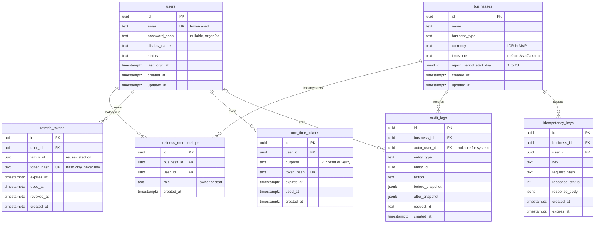
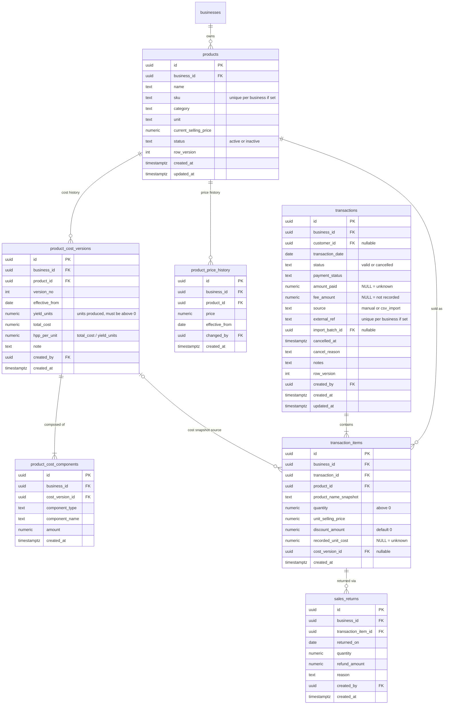
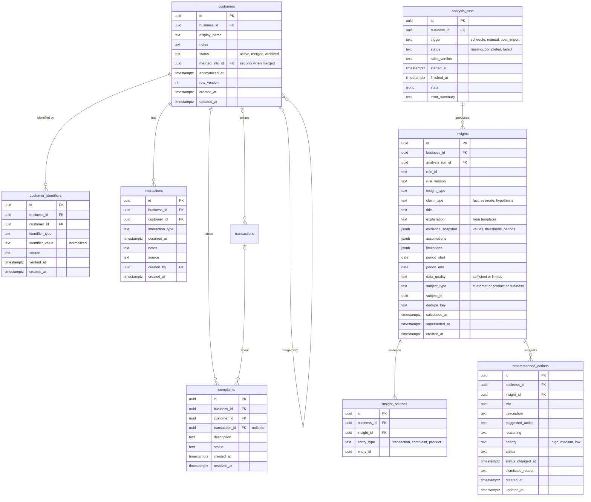
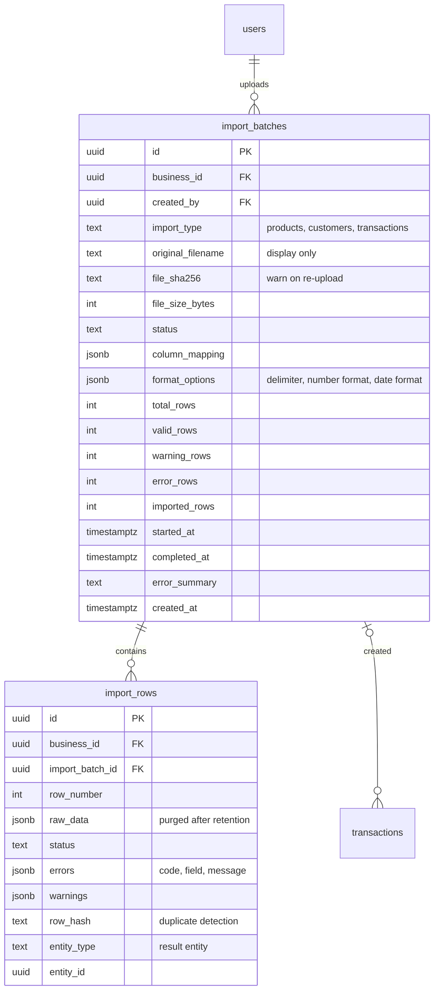

# ERD — Teman UMKM (MVP)

Status: Draft v1.0 · Owner: `backend-ai` · Sources: `project-map/prd.md` §9, `project-map/trd.md`
Engine: PostgreSQL · Migrations: versioned SQL files · Queries: GORM
Render: GitHub, or VS Code with a Mermaid preview extension.
Every business-owned table has `business_id → businesses.id`. Those edges are omitted from the diagrams for readability.

## 1. Conventions (apply to every table)

| Topic            | Rule                                                                                                                                                                                          |
| ---------------- | --------------------------------------------------------------------------------------------------------------------------------------------------------------------------------------------- |
| Primary key      | `id UUID`, generated in the app (UUIDv7, time-ordered).                                                                                                                                       |
| Tenancy          | Every business-owned table has `business_id UUID NOT NULL`.                                                                                                                                   |
| Tenant integrity | Parent tables have `UNIQUE (business_id, id)`. Child tables reference parents with a **composite FK** `(business_id, parent_id)`. The database itself then rejects cross-business references. |
| Money            | Totals `NUMERIC(18,2)`. Unit prices and unit costs `NUMERIC(18,4)`. Quantity `NUMERIC(14,3)`. Never float. The API sends money as **strings**.                                                |
| Percentages      | Never stored. Computed on read.                                                                                                                                                               |
| Time             | `*_at` = `TIMESTAMPTZ` (UTC). Business calendar dates (`transaction_date`, `effective_from`, ...) = `DATE` in the business timezone.                                                          |
| Enums            | `TEXT` + `CHECK` (values in §6). No native ENUM types, so migrations stay simple.                                                                                                             |
| Unknown vs zero  | `NULL` = unknown or not recorded. `0` = recorded as zero. Applies to `recorded_unit_cost`, `fee_amount`, `amount_paid`.                                                                       |
| Deletion         | No hard delete of business history. Use status columns. FKs to history use `ON DELETE RESTRICT`. No GORM `DeletedAt`.                                                                         |
| Concurrency      | Mutable core rows carry `row_version INT NOT NULL DEFAULT 1` (optimistic locking).                                                                                                            |
| Timestamps       | `created_at`, `updated_at` default `now()`.                                                                                                                                                   |
| Naming           | snake_case, plural table names.                                                                                                                                                               |

## 2. Diagram A — Identity, Tenancy, Audit

## 3. Diagram B — Catalog and Sales

## 4. Diagram C — Customers and Intelligence

## 5. Diagram D — CSV Import

## 6. Enum Values (TEXT + CHECK)

| Column                                 | Values                                                                                                  |
| -------------------------------------- | ------------------------------------------------------------------------------------------------------- |
| users.status                           | active, disabled                                                                                        |
| business_memberships.role              | owner, staff                                                                                            |
| products.status                        | active, inactive                                                                                        |
| product_cost_components.component_type | ingredient, packaging, direct_labor, other_direct, allocated_overhead                                   |
| transactions.status                    | valid, cancelled                                                                                        |
| transactions.payment_status            | paid, partial, unpaid, unknown                                                                          |
| transactions.source                    | manual, csv_import (later: whatsapp, marketplace)                                                       |
| customers.status                       | active, merged, archived                                                                                |
| customer_identifiers.identifier_type   | phone, email, marketplace_username, external_ref                                                        |
| interactions.interaction_type          | call, message, visit, note, follow_up                                                                   |
| complaints.status                      | open, in_progress, resolved, dismissed                                                                  |
| analysis_runs.trigger / status         | schedule, manual, post_import / running, completed, failed                                              |
| insights.insight_type                  | customer_activity, product_profitability, data_health, period_comparison                                |
| insights.claim_type                    | fact, estimate, hypothesis                                                                              |
| insights.data_quality                  | sufficient, limited                                                                                     |
| recommended_actions.priority           | high, medium, low                                                                                       |
| recommended_actions.status             | new, reviewed, in_progress, completed, dismissed                                                        |
| import_batches.import_type             | products, customers, transactions                                                                       |
| import_batches.status                  | uploaded, mapped, validated, confirmed, processing, completed, completed_with_errors, failed, cancelled |
| import_rows.status                     | pending, valid, warning, error, imported, skipped                                                       |

## 7. Constraints

**Unique**

- `users (lower(email))`
- `business_memberships (business_id, user_id)`
- `products (business_id, sku) WHERE sku IS NOT NULL`
- `product_cost_versions (product_id, version_no)`
- `customer_identifiers (business_id, identifier_type, identifier_value)`
- `transactions (business_id, external_ref) WHERE external_ref IS NOT NULL`
- `insights (business_id, dedupe_key) WHERE superseded_at IS NULL` (one active insight per key)
- `analysis_runs (business_id) WHERE status = 'running'` (no concurrent runs per business)
- `import_rows (import_batch_id, row_number)`
- `idempotency_keys (business_id, user_id, key)`
- `refresh_tokens (token_hash)`

**Composite FKs (tenant integrity).** Each of these references `(business_id, id)` of the parent:
`transactions → customers`, `transaction_items → transactions`, `transaction_items → products`, `transaction_items → product_cost_versions`, `sales_returns → transaction_items`, `product_cost_versions → products`, `product_cost_components → product_cost_versions`, `product_price_history → products`, `customer_identifiers → customers`, `interactions → customers`, `complaints → customers`, `insights → analysis_runs`, `insight_sources → insights`, `recommended_actions → insights`, `import_rows → import_batches`.

**CHECK**

- `transaction_items`: quantity > 0; unit_selling_price ≥ 0; 0 ≤ discount_amount ≤ quantity × unit_selling_price; recorded_unit_cost IS NULL OR ≥ 0.
- `sales_returns`: quantity > 0; refund_amount ≥ 0. The rule "sum of returned quantity ≤ item quantity" is enforced in the service inside a transaction with a row lock.
- `product_cost_versions`: yield_units > 0; total_cost ≥ 0. `hpp_per_unit` is computed by the finance package and verified by unit tests.
- `product_cost_components`: amount ≥ 0. `products`: current_selling_price ≥ 0.
- `transactions`: status = 'cancelled' ⇒ cancelled_at IS NOT NULL; amount_paid and fee_amount are NULL or ≥ 0.
- `customers`: merged_into_id IS NOT NULL ⇔ status = 'merged'; merged_into_id ≠ id.
- `businesses`: currency = 'IDR'; report_period_start_day BETWEEN 1 AND 28. The timezone is validated in the app against IANA names.
- `insights`: period_start ≤ period_end.

**Database roles**

- `app_rw`: no DDL. **No UPDATE or DELETE on `audit_logs`** (append-only).
- `migrator`: DDL only, used by the migration step.

## 8. Indexes (start with these; add more only when EXPLAIN shows a need)

| Table               | Index                                                                                                               |
| ------------------- | ------------------------------------------------------------------------------------------------------------------- |
| transactions        | `(business_id, transaction_date DESC) WHERE status = 'valid'` · `(business_id, customer_id, transaction_date DESC)` |
| transaction_items   | `(business_id, transaction_id)` · `(business_id, product_id)`                                                       |
| sales_returns       | `(business_id, transaction_item_id)`                                                                                |
| customers           | `(business_id, status)` · trigram GIN on `display_name` (search)                                                    |
| interactions        | `(business_id, customer_id, occurred_at DESC)`                                                                      |
| complaints          | `(business_id, customer_id, status)`                                                                                |
| insights            | `(business_id, created_at DESC)` · `(business_id, insight_type, superseded_at)`                                     |
| insight_sources     | `(insight_id)` · `(business_id, entity_type, entity_id)`                                                            |
| recommended_actions | `(business_id, status, priority)`                                                                                   |
| audit_logs          | `(business_id, entity_type, entity_id, created_at DESC)` · `(business_id, created_at DESC)`                         |
| import_rows         | `(import_batch_id, status)`                                                                                         |
| refresh_tokens      | `(user_id)` · `(family_id)`                                                                                         |

## 9. Derived Data (computed, not stored)

- Per customer: first and last transaction date, transaction count, total value in a period, purchase intervals.
- Per product: gross margin, units sold, ranking.
- Dashboard metrics: net sales, COGS, gross profit, margin, cost coverage.

Storing these risks drift from the source rows. If a measured performance problem appears, add a cache table or materialized view through a decision record.

## 10. Cost Resolution and Snapshots

- Cost in effect for product P on date D = the `product_cost_versions` row with the greatest `effective_from ≤ D` (tie-break: greatest `version_no`).
- When a transaction item is created, copy that `hpp_per_unit` into `recorded_unit_cost` and set `cost_version_id`. If no version exists, both stay `NULL` (**unknown, not zero**).
- Later cost or price changes never rewrite existing transaction items. Cost versions are append-only.

## 11. Customer Rules in the Model

- Link or merge automatically **only on an exact normalized identifier match** (`customer_identifiers`). Never on name similarity.
- Merge: the source customer gets `status = 'merged'` and `merged_into_id`. Transactions, interactions, and complaints are re-pointed to the target in one DB transaction and audit-logged. A user confirmation is mandatory.
- Anonymize (privacy request): set `display_name` to a placeholder, clear `notes`, delete `customer_identifiers`, set `anonymized_at`. Transactions stay for financial history.

## 12. Retention (initial defaults, owner to confirm)

| Data                   | Default                                                            |
| ---------------------- | ------------------------------------------------------------------ |
| `import_rows.raw_data` | purged 30 days after batch completion (row status and counts kept) |
| `refresh_tokens`       | purged 7 days after expiry                                         |
| `idempotency_keys`     | expire after 24 hours                                              |
| `audit_logs`           | retained; policy to be decided by the owner                        |

## 13. Deviations from PRD §9

1. `product_cost_components` now hangs under the new `product_cost_versions`. The PRD formula is HPP = total cost / units produced, and history must be immutable. The PRD's `cost_per_unit` column becomes `amount` (batch total).
2. Added tables: `product_price_history`, `sales_returns`, `import_batches`, `import_rows`, `analysis_runs`, `insight_sources`, `refresh_tokens`, `one_time_tokens` (P1), `idempotency_keys`.
3. `users.password_hash_or_auth_provider` → nullable `password_hash`. External login providers would be added later through a separate identities table.
4. `customers`: first/last transaction date and transaction count are derived (§9), not stored.
5. `transactions`: date is `DATE`. Added payment, fee, `external_ref`, `import_batch_id`, and cancellation columns.
6. `insights`: `confidence_or_data_quality` → `data_quality`. Added `claim_type`, `rule_id`, `rule_version`, `dedupe_key`, `superseded_at`, `assumptions`, `limitations`.
7. `recommended_actions`: added fields to satisfy the PRD §5.10 structure.
8. `audit_logs`: added `request_id`, and the table is append-only.
9. There is **no expenses table**, so net profit is not computed in the MVP (see TRD A4).

## 14. Migration Order (files `NNNNNN_name.up.sql` / `.down.sql`)

1. Extensions (case-insensitive text, trigram) and DB roles
2. users, businesses, business_memberships
3. refresh_tokens, one_time_tokens, audit_logs, idempotency_keys
4. products, product_cost_versions, product_cost_components, product_price_history
5. customers, customer_identifiers
6. import_batches, import_rows
7. transactions, transaction_items, sales_returns
8. interactions, complaints
9. analysis_runs, insights, insight_sources, recommended_actions

Every migration must run `up` and `down` cleanly on an empty database and on a seeded one. `AutoMigrate` is never used.
