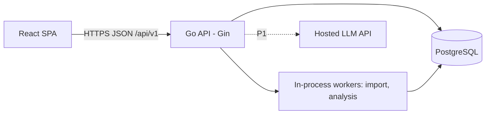

# TRD — Teman UMKM (MVP)

Status: Draft v1.0 · Source: `prd.md` · Data model: `contracts/erd.md`
Labels used here: **Decision** (chosen), **Assumption** (owner must confirm; may change the model), **Target** (goal, not yet measured).

## 0. How agents use this document

Read only the sections you need. Do not load the whole file for a small task.

| Agent      | Read                                                                                    |
| ---------- | --------------------------------------------------------------------------------------- |
| Leader     | §1, §13, §14                                                                            |
| Designer   | §6 (what numbers mean), §7 (insight fields), §8 (import flow), §9 (screens ↔ endpoints) |
| Backend-AI | everything relevant to the module being built, plus `erd.md`                            |
| Frontend   | §5 (TD-13 conventions), §6, §8, §9, plus `contracts/api-*.md`                           |
| Tester     | §10, §12, the PRD acceptance criteria, plus `erd.md` §7                                 |

## 1. Scope and Assumptions

**MVP = PRD §4.1 (all P0).** P1 items: AI assistant, XLSX import, staff invitations, password reset and email verification, report export.

| ID  | Assumption (owner to confirm)                                                                                                                                                                                                                                         |
| --- | --------------------------------------------------------------------------------------------------------------------------------------------------------------------------------------------------------------------------------------------------------------------- |
| A1  | Accounts are owner-only in the MVP. The `staff` role exists in the schema, but invitations are P1.                                                                                                                                                                    |
| A2  | The MVP imports **CSV only**. The PRD says "CSV atau spreadsheet". XLSX is P1.                                                                                                                                                                                        |
| A3  | Returns are recorded per transaction item. Returned goods are not restocked, so COGS is unchanged (conservative for food). Credit and partial payment are tracked only through `payment_status` and `amount_paid`, with no receivables ledger. (PRD open question 9.) |
| A4  | There is no operating-expense data in the MVP, so **net profit is not calculated**. The UI shows "tidak tersedia" with the reason.                                                                                                                                    |
| A5  | A transaction date is a calendar date in the business timezone, with no time of day.                                                                                                                                                                                  |
| A6  | Single currency (IDR) and a single branch.                                                                                                                                                                                                                            |
| A7  | No custom ML, so **no Python inference service**. An LLM (P1 only) is a hosted API called from Go.                                                                                                                                                                    |
| A8  | Hosting provider, domain, and email provider are undecided (see §14).                                                                                                                                                                                                 |

## 2. Architecture

**Decision TD-01: modular monolith, one deployable.** It is the simplest option for an MVP team. Modules talk through small interfaces, so a module can be split out later without a rewrite. Workers run inside the API process and claim work from the database.

## 3. Stack and Tooling

| Area             | Choice                                                                                                                                                                                                             |
| ---------------- | ------------------------------------------------------------------------------------------------------------------------------------------------------------------------------------------------------------------ |
| Backend          | Go (latest stable, pinned in `go.mod`), Gin, GORM + pgx, `shopspring/decimal`, UUIDv7 (e.g. `google/uuid`), `golang-jwt`, argon2id (`x/crypto`), `slog`, a SQL migration tool (golang-migrate, goose, or atlas)    |
| Database         | PostgreSQL (latest supported major), local dev via Docker Compose                                                                                                                                                  |
| Frontend         | React + TypeScript (strict) + Vite, React Router, TanStack Query, React Hook Form + Zod, `Intl.NumberFormat('id-ID')` for Rupiah                                                                                   |
| Charts           | The smallest library that meets the Designer's spec, chosen by Frontend                                                                                                                                            |
| CI (recommended) | GitHub Actions. Backend: `go build`, `go vet`, `golangci-lint`, `go test`, `govulncheck`. Frontend: lint, `tsc --noEmit`, tests, build. CI is informational; agents still run these checks locally before pushing. |

Pin exact versions in `go.mod` and the lockfile. Do not hard-code version numbers in this document.

## 4. Backend Modules

Layout follows Backend-AI's SOUL: `internal/<module>/` (handler, service, repository, dto) and `internal/platform/`.

| Package          | Responsibility                                                     | Owns tables                                                   | PRD      |
| ---------------- | ------------------------------------------------------------------ | ------------------------------------------------------------- | -------- |
| `auth`           | register, login, refresh, logout, token handling                   | users, refresh_tokens, one_time_tokens                        | 5.1      |
| `business`       | business profile and settings, membership, tenant middleware       | businesses, business_memberships                              | 5.1      |
| `catalog`        | products, cost versions, price history, pricing calculator         | products, product*cost*\*, product_price_history              | 5.2, 5.3 |
| `customer`       | customers, identifiers, interactions, complaints, merge, anonymize | customers, customer_identifiers, interactions, complaints     | 5.7      |
| `sales`          | transactions, items, returns, cancel                               | transactions, transaction_items, sales_returns                | 5.4      |
| `finance`        | pure calculation functions and dashboard queries (read-only)       | none                                                          | 5.3, 5.6 |
| `importer`       | upload, parse, map, validate, process                              | import_batches, import_rows                                   | 5.5      |
| `insight`        | rules, analysis runs, recommendations, provenance                  | analysis_runs, insights, insight_sources, recommended_actions | 5.9–5.11 |
| `audit`          | append-only audit writer                                           | audit_logs                                                    | 5.4, 8.1 |
| `assistant` (P1) | LLM tool layer                                                     | none                                                          | 5.12     |
| `platform`       | config, db, http server, logger, errors, rate limit, idempotency   | idempotency_keys                                              | —        |

Dependency rule: no import cycles. `sales` uses `catalog` and `customer` through interfaces defined in `sales`. `finance` and `insight` read through read-only repository interfaces. `finance` has **no database or HTTP imports in its calculation functions**, so they stay pure and easy to test.

## 5. Key Decisions

| ID                                 | Decision                                                                                                                                                                                                                                                                                                                                                                                                                                                                                                                                                                                 |
| ---------------------------------- | ---------------------------------------------------------------------------------------------------------------------------------------------------------------------------------------------------------------------------------------------------------------------------------------------------------------------------------------------------------------------------------------------------------------------------------------------------------------------------------------------------------------------------------------------------------------------------------------- |
| TD-02 Numbers                      | Money, quantity, and cost use `decimal` in Go and `NUMERIC` in PostgreSQL (types in `erd.md` §1). Never float. Rounding: ROUND_HALF_UP to 2 decimals when persisting a computed amount. All computation happens at full decimal precision first. The API sends money as **strings**.                                                                                                                                                                                                                                                                                                     |
| TD-03 Dates                        | `transaction_date` is a `DATE` in the business timezone (A5). A period filter is an inclusive date range. "Previous period" = the same number of days immediately before.                                                                                                                                                                                                                                                                                                                                                                                                                |
| TD-04 IDs                          | UUIDv7 generated in the app. Never expose sequential IDs.                                                                                                                                                                                                                                                                                                                                                                                                                                                                                                                                |
| TD-05 Tenant isolation             | Four layers: (1) routes are path-scoped `/businesses/{business_id}/...` and middleware verifies membership; (2) **every repository method requires `businessID`** (no method without it); (3) composite FKs in the DB (`erd.md` §7); (4) automated cross-tenant tests (§12). Row-Level Security is an optional extra hardening step for Leader to decide before production.                                                                                                                                                                                                              |
| TD-06 Auth                         | Email + password (argon2id). Access token: JWT, pinned algorithm (HS256 with a strong secret from env), kept in memory by the SPA and sent as a Bearer header. Refresh token: random, stored **hashed** in `refresh_tokens`, delivered in an httpOnly, Secure, SameSite cookie scoped to the refresh path, **rotated on every use**, with family-based reuse detection (reuse revokes the family). Initial defaults: access 15 min, refresh 14 days (Targets, adjustable). Cookie endpoints (refresh, logout) check the `Origin` header. Generic auth error messages. Rate limits (§10). |
| TD-07 Async work                   | The database is the queue. A worker claims a unit of work with `SELECT ... FOR UPDATE SKIP LOCKED` on `import_batches`. The scheduler runs inside the API and uses a Postgres advisory lock so multiple instances do not double-run. Graceful shutdown lets workers finish the current chunk.                                                                                                                                                                                                                                                                                            |
| TD-08 Immutable history            | Cost versions are append-only. A transaction item snapshots cost at creation (`erd.md` §10). Editing a transaction is allowed, with an audit entry, and re-snapshots only on explicit user request.                                                                                                                                                                                                                                                                                                                                                                                      |
| TD-09 Unknown vs zero              | `NULL` = unknown. Calculations skip unknown values and report **coverage**. Unknown never silently becomes 0.                                                                                                                                                                                                                                                                                                                                                                                                                                                                            |
| TD-10 Safe retries and concurrency | `POST` endpoints that create transactions accept an `Idempotency-Key` header (stored in `idempotency_keys`). Mutable rows use `row_version`. A stale update returns 409.                                                                                                                                                                                                                                                                                                                                                                                                                 |
| TD-11 Audit                        | Create, update, cancel, merge, anonymize, import, and status changes write to `audit_logs` in the **same DB transaction** as the change. Snapshots contain only needed fields, with no secrets and minimal PII.                                                                                                                                                                                                                                                                                                                                                                          |
| TD-12 Insight text                 | P0 insight and recommendation text comes from **deterministic Indonesian templates** filled from evidence. P0 needs **no LLM**: zero AI cost and no hallucination risk.                                                                                                                                                                                                                                                                                                                                                                                                                  |
| TD-13 API conventions              | Prefix `/api/v1`. JSON, snake_case. List: `{items, page, page_size, total}` (default 20, max 100). Error: `{error:{code,message,details?}}`. `code` is a stable English string, `message` is user-safe Indonesian. Request and response DTOs are separate from GORM models. Money is a string. Dates are `YYYY-MM-DD`. Timestamps are RFC 3339 UTC.                                                                                                                                                                                                                                      |
| TD-14 Migrations and queries       | Versioned SQL migrations (`migrations/`). No `AutoMigrate`. GORM for CRUD. Raw parameterized SQL is allowed for dashboard aggregates (ORM limitation), documented where used.                                                                                                                                                                                                                                                                                                                                                                                                            |

## 6. Calculation Spec (`finance` package)

**Per transaction item (valid transactions only)**

- `gross = quantity × unit_selling_price`
- `refunds = Σ sales_returns.refund_amount` for the item
- `net = gross − discount_amount − refunds`
- `cogs = quantity × recorded_unit_cost` if the cost is known, otherwise **unknown**. Returned goods do not reduce COGS (A3).

**Period totals** (cancelled transactions excluded)

- `net_sales = Σ net` over all items
- `costed_net_sales = Σ net` over items with known cost
- `cogs = Σ cogs` over costed items
- `gross_profit = costed_net_sales − cogs`
- `gross_margin = gross_profit / costed_net_sales`. **Null** when `costed_net_sales = 0`. Never divide by zero.
- `cost_coverage = costed_net_sales / net_sales`
- `is_estimate = cost_coverage < 100%`
- `cash_received = Σ amount_paid` over transactions with payment data. Always shown with its data coverage.
- `recorded_fees = Σ fee_amount` over transactions with a recorded fee. Shown separately, not part of gross profit.
- `net_profit`: **not available** (A4).

**Pricing calculator (stateless, authoritative on the backend)**

- `hpp_per_unit = total_allocated_cost / yield_units`
- `gross_profit_per_unit = price − hpp_per_unit`
- `gross_margin = gross_profit_per_unit / price`
- `price_for_target = hpp_per_unit / (1 − target_margin)`, valid only for `0 < target_margin < 1`
- A warning flag is returned when `price < hpp_per_unit`.
- The frontend may show a live preview with the same formula, but the saved result comes from the backend.

**Naming rule:** the UI says "laba kotor", never just "laba". Whenever `is_estimate` is true it shows "estimasi" plus the missing-cost count.

**Golden test cases (must exist as unit tests)**

| Case                  | Input                                                                                                              | Expected                                                                                                                                                           |
| --------------------- | ------------------------------------------------------------------------------------------------------------------ | ------------------------------------------------------------------------------------------------------------------------------------------------------------------ |
| Pricing               | total cost 100,000; 20 units; target margin 40%                                                                    | HPP 5,000; price 8,333.33                                                                                                                                          |
| Partial cost coverage | Item A: qty 10, price 25,000, discount 10,000, cost 15,000. Item B: qty 5, price 30,000, no discount, cost unknown | net A 240,000; net B 150,000; net_sales 390,000; costed_net_sales 240,000; cogs 150,000; gross_profit 90,000; margin 37.5%; cost_coverage 61.54%; is_estimate true |
| Return                | Item A as above plus a refund of 25,000                                                                            | net A 215,000; cogs 150,000; gross_profit 65,000; margin 30.23%                                                                                                    |
| Zero                  | net_sales 0                                                                                                        | margin null (not an error)                                                                                                                                         |
| Cancelled             | a cancelled transaction                                                                                            | excluded from every total                                                                                                                                          |

## 7. Insight Engine Spec

**Pipeline:** trigger (daily schedule per business, after an import, or manual with a cooldown) → create `analysis_runs` row (unique running run per business) → for each rule: **data gate** → evaluate → build `evidence_snapshot` (values, thresholds, period, source IDs) → upsert insight by `dedupe_key` → render explanation from template → create or update `recommended_actions` → supersede insights whose condition no longer holds.

**Lifecycle**

- Same `dedupe_key` and same conclusion: update `calculated_at` and evidence in place. The recommendation's status is kept.
- Condition no longer holds: set `superseded_at`. The linked action stays, flagged "kondisi sudah berubah".
- A dismissed recommendation is not recreated for the same `dedupe_key` within a cooldown (default 14 days, a Target).

**Initial rule set.** All numbers below are **initial defaults (Targets), not validated values.** They live in code config under `rule_version` and change only with a version bump. Calibrate during the pilot (see Evaluation).

| Rule ID                  | Signal                                      | Data gate                                              | Trigger                                                             | claim_type |
| ------------------------ | ------------------------------------------- | ------------------------------------------------------ | ------------------------------------------------------------------- | ---------- |
| `CUST_OVERDUE_V1`        | Customer past their usual purchase interval | ≥ 4 distinct purchase dates in the last 180 days       | `days_since_last > max(1.5 × median_interval, median_interval + 7)` | hypothesis |
| `CUST_FREQ_DROP_V1`      | Purchase frequency dropped                  | ≥ 4 purchases in the previous 90 days                  | purchases in the last 90 days ≤ 0.5 × previous 90 days              | hypothesis |
| `CUST_VALUE_DROP_V1`     | Average transaction value dropped           | ≥ 4 purchases previously and ≥ 2 recently              | recent average ≤ 0.6 × previous average                             | hypothesis |
| `CUST_COMPLAINT_OPEN_V1` | Unresolved complaint                        | complaint status open or in_progress                   | open longer than 3 days                                             | fact       |
| `PROD_BELOW_COST_V1`     | Selling price below current HPP             | product has a current cost version                     | `current_selling_price < hpp_per_unit`                              | fact       |
| `PROD_LOW_MARGIN_V1`     | Margin well below the business average      | product has costed sales ≥ minimum units in the period | margin ≥ 10 percentage points below the business-wide margin        | estimate   |
| `DATA_MISSING_COST_V1`   | Sales exist for items without cost          | ≥ 1 costed-unknown item in the period                  | cost_coverage < 100%                                                | fact       |
| `DATA_UNLINKED_TX_V1`    | Many transactions without a customer        | ≥ 20 transactions in the period                        | share without customer > 30%                                        | fact       |

**Priority:** base priority per rule. A customer in the top 20% by revenue in the last 180 days gets one level higher.

**Insight content** (satisfies PRD §5.9–5.11): title; explanation; evidence (last transaction date, number of transactions used, historical pattern, observation period); assumptions; limitations; data period; rule ID + version; calculated time; links to source rows (`insight_sources`) so the user can open the supporting history.

**Guardrails**

- New customers and customers below the data gate get no risk label.
- Templates never state certainty ("pasti berhenti"). Wording stays hypothetical for `hypothesis` insights.
- A rule never links a customer by name similarity.
- If data is insufficient, the engine creates **no recommendation**, or a `data_health` insight that says what is missing.
- Customer-relationship signals stay separate from business-financial signals (`insight_type`).

**Evaluation (backtest).** Provide a backtest command (e.g. `cmd/backtest`) that, for a chosen cutoff date `T` on anonymized pilot data, runs each customer rule and measures: how many customers were flagged, how many of those did buy within the following window, and how many customers that stopped buying were missed. Report in `inbox/leader/`. Targets are set only after a baseline exists (PRD §11). Until then report **observed** numbers only, labeled as observations.

## 8. CSV Import Spec

**States:** `uploaded → mapped → validated → confirmed → processing → completed | completed_with_errors | failed | cancelled`. An upload creates a batch, the user maps columns, the system validates rows, the user reviews errors and warnings, then confirms.

**Parsing**

- UTF-8 only (BOM stripped). Any other encoding gives a clear error.
- Delimiter auto-detected (comma, semicolon, tab) with a user override. Indonesian Excel often exports `;`.
- A header row is required.
- **Number format is chosen in the mapping step:** `1.500,50` (id-ID) or `1,500.50` (en). Ambiguous values (like `1.500`) are flagged for the user rather than guessed.
- **Date format is chosen in the mapping step:** `DD/MM/YYYY` (default), `DD-MM-YYYY`, or `YYYY-MM-DD`.
- Initial limits (Targets, configurable): 5 MB and 20,000 rows. Enforced while streaming, before any processing.
- Cells are always text, never evaluated. The original file is **not stored**: parsed rows go to `import_rows`, and only the file's SHA-256 is kept so a repeat upload can be warned about.

**Templates (columns)**

- Products: `name, sku, category, unit, selling_price, hpp_per_unit (optional)`. An optional `hpp_per_unit` creates a first cost version with a single component "HPP (impor)".
- Customers: `name, phone, email, notes`.
- Transactions (one row per item): `order_ref, date, customer_name, customer_phone, product_sku, product_name, quantity, unit_price, discount, payment_status, fee`. Rows sharing an `order_ref` form one transaction. An empty `order_ref` means one transaction per row.

**Validation**

- Every row gets errors and warnings as `{code, field, message}`, with Indonesian messages.
- Product match: by SKU, else by exact name (trimmed, case-insensitive). **No fuzzy matching.** No match is an error.
- Customer match: **only** by exact normalized identifier. Phone normalized to international format with default country +62 (`0812…` → `+62812…`). A name-only match is never merged. It creates a new customer plus a "kemungkinan pelanggan yang sama" warning.
- Duplicate candidates (same `external_ref`, or same `row_hash`) are warnings the user decides on.

**Processing**

- A worker claims the batch (TD-07) and processes it in chunks, with a savepoint per row, so one bad row never rolls back the others.
- `confirm` is idempotent (state check under a row lock). A resumed batch processes only `pending` and `valid` rows. Rows with an `external_ref` rely on the unique constraint, so a repeat cannot duplicate data.
- The summary shows imported, skipped, and errored counts, and offers an error-row download. **CSV export neutralizes cells beginning with `=`, `+`, `-`, `@`** (formula injection).
- Cancelling an import of transactions cancels the transactions it created, with an audit entry.

## 9. API Inventory

Business routes live under `/api/v1/businesses/{business_id}/…`. The detailed contract (schemas, errors) goes in `contracts/api-<feature>.md`, written by Backend-AI before implementation.

| Module   | Endpoints                                                                                                                                                                                                                                                    |
| -------- | ------------------------------------------------------------------------------------------------------------------------------------------------------------------------------------------------------------------------------------------------------------ |
| auth     | `POST /auth/register`, `/auth/login`, `/auth/refresh`, `/auth/logout`, `GET /auth/me`                                                                                                                                                                        |
| business | `POST /businesses`, `GET/PATCH /businesses/{bid}`                                                                                                                                                                                                            |
| catalog  | `GET/POST /products`, `GET/PATCH /products/{id}`, `POST /products/{id}/deactivate`, `GET/POST /products/{id}/cost-versions`, `GET /products/{id}/price-history`, `POST /pricing/calculate`                                                                   |
| customer | `GET/POST /customers`, `GET/PATCH /customers/{id}`, `GET /customers/{id}/transactions`, `GET/POST /customers/{id}/interactions`, `POST /customers/{id}/complaints`, `PATCH /complaints/{id}`, `POST /customers/{id}/merge`, `POST /customers/{id}/anonymize` |
| sales    | `GET/POST /transactions`, `GET/PATCH /transactions/{id}`, `POST /transactions/{id}/cancel`, `POST /transactions/{id}/returns`                                                                                                                                |
| finance  | `GET /dashboard/summary`, `GET /dashboard/products`, `GET /dashboard/data-health` (all take `from` and `to`)                                                                                                                                                 |
| importer | `GET /imports/templates/{type}`, `POST /imports`, `GET /imports/{id}`, `PUT /imports/{id}/mapping`, `GET /imports/{id}/rows`, `POST /imports/{id}/confirm`, `POST /imports/{id}/cancel`                                                                      |
| insight  | `GET /insights`, `GET /insights/{id}` (with sources), `GET /recommendations`, `PATCH /recommendations/{id}`, `POST /analysis/run`                                                                                                                            |
| ops      | `GET /health` (liveness), `GET /ready` (dependencies)                                                                                                                                                                                                        |
| P1       | `POST /assistant/ask`, report export, password reset, staff invitations                                                                                                                                                                                      |

## 10. Security and Privacy Requirements

| Requirement                               | Implementation                                                                                                                                                                                                                                                | Verified by                                                                                                                            |
| ----------------------------------------- | ------------------------------------------------------------------------------------------------------------------------------------------------------------------------------------------------------------------------------------------------------------- | -------------------------------------------------------------------------------------------------------------------------------------- |
| No cross-business access (PRD 8.1)        | TD-05, composite FKs                                                                                                                                                                                                                                          | Tester: access matrix on every route, plus a **route inventory test** that fails if a registered route has no authorization test entry |
| Authentication                            | TD-06                                                                                                                                                                                                                                                         | Tester: expired, tampered, wrong-algorithm, reused-refresh, logout cases                                                               |
| Safe CSV handling                         | §8 limits, text-only cells, no stored file, export neutralization                                                                                                                                                                                             | Tester: malformed, oversized, formula, wrong-encoding files                                                                            |
| Rate limiting (initial defaults, Targets) | login and refresh: 10 per 15 min per IP and account; import upload: 5 per hour per business; manual analysis: 1 per 10 min per business; assistant (P1): per-day quota                                                                                        | Tester                                                                                                                                 |
| Transport and browser                     | HTTPS only, strict CORS allowlist for the frontend origin, security headers, request body limits, server timeouts                                                                                                                                             | Tester                                                                                                                                 |
| Secrets                                   | Env only, never in git or the frontend bundle                                                                                                                                                                                                                 | gitleaks plus review                                                                                                                   |
| Logging                                   | `slog` JSON with `request_id`. Never log passwords, tokens, PII, or raw CSV rows                                                                                                                                                                              | Tester                                                                                                                                 |
| Audit                                     | TD-11, `audit_logs` append-only at the DB-privilege level                                                                                                                                                                                                     | Tester                                                                                                                                 |
| Privacy (PRD 8.2)                         | Collect only needed customer data. Anonymize flow (`erd.md` §11). Retention defaults (`erd.md` §12). Encryption in transit; encryption at rest by the managed database or disk. Field-level encryption of identifiers is a Leader decision before production. | Review                                                                                                                                 |
| Backup and recovery (PRD 8.1)             | Managed backups with point-in-time recovery if the provider offers it, and a **restore drill before any production use**                                                                                                                                      | Manual Task (§14)                                                                                                                      |
| Legal                                     | Indonesian personal data protection law (UU PDP, UU No. 27/2022) and PRD §8.2 need review by the owner or legal counsel. This document is not legal advice and compliance has not been verified.                                                              | Manual Task                                                                                                                            |

## 11. AI Assistant (P1) Design

The assistant is not required for any core MVP feature.

- **Fixed read-only tools, no free-form SQL.** The LLM chooses among parameterized functions that call the `finance` and `insight` modules (e.g. margin by product for a period, overdue customers). Tool execution injects `business_id` from the authenticated session. The LLM can never supply or change it.
- **Numbers come only from tool results.** A post-check verifies that every number in the answer appears in the tool outputs. If it does not, the answer is rejected or regenerated. Answers include the period and data source. Missing data is stated plainly.
- **Privacy:** the LLM sees pseudonyms (`Pelanggan A`, `P1`), never phone numbers or emails. The server maps pseudonyms back to names after the answer is validated.
- **Untrusted text:** customer notes, complaint text, and product names are data, delimited and never treated as instructions. No tool writes data or sends messages.
- **Cost control:** max tokens, per-business daily quota, request timeout, a provider interface (`Completer`) so providers are swappable and tests use fakes.
- **Evaluation:** a fixed question set whose expected numbers come from the finance engine. A numeric mismatch fails the test. Also measure refusal correctness (questions about missing data or other businesses), groundedness, latency, and cost per question. No targets until a baseline exists.

## 12. Non-Functional Targets and Test Strategy

**Targets (from PRD §8.3, not yet measured):** dashboard p95 < 2 s; standard CRUD p95 < 500 ms; imports above the size threshold run asynchronously with visible progress.
**Proposed reference dataset for measuring (owner to confirm):** one business with about 10,000 transactions, 50,000 items, 2,000 customers, 200 products.

| Test area             | What                                                                                                                                                 |
| --------------------- | ---------------------------------------------------------------------------------------------------------------------------------------------------- |
| Finance               | The golden cases in §6, plus property-style tests (totals equal the sum of lines, cancelled excluded, null-margin rule)                              |
| Tenant isolation      | Two businesses with one owner each. Every route is called with the other business's IDs in path, query, and body. Includes the route inventory test. |
| Insight rules         | Synthetic purchase histories for each rule (flagged, not flagged, below the data gate), plus the backtest harness                                    |
| Import                | Messy fixtures: semicolon delimiter, BOM, id-ID numbers, bad dates, duplicate rows, oversized file, formulas, wrong encoding                         |
| Concurrency and retry | Double-submit with the same idempotency key, parallel `confirm`, stale `row_version` update                                                          |
| Migrations            | `up` and `down` on empty and seeded databases                                                                                                        |
| Frontend              | Component and flow tests for the critical paths: setup, add product, add transaction, import, dashboard, insight detail                              |

**Seed and fixtures:** a `cmd/seed` (or equivalent) creates two businesses with an owner each, products with costs, customers, and a spread of transactions including edge cases (unknown cost, cancelled, returned, unlinked customer). Backend-AI provides it for Tester and for demos.

**Observability:** structured logs with `request_id`, `/health` and `/ready`. Basic metrics can be added after the first deployment.

## 13. Build Order (proposal; Leader owns the board)

Designer works one milestone ahead of Frontend. Each milestone ends with pushed commits and a Tester pass on its endpoints. Sizes follow the SOUL task sizing.

| #   | Milestone                                                                                                                         | Size      | Done when                                                |
| --- | --------------------------------------------------------------------------------------------------------------------------------- | --------- | -------------------------------------------------------- |
| M0  | Foundation: both repos scaffolded, config, migration tooling, Docker Compose DB, CI, design direction and tokens, API conventions | Standard  | App boots, `/health` OK, one migration applies           |
| M1  | Auth, business setup, membership, tenant middleware, audit writer                                                                 | **Large** | Access matrix passes; no cross-business access           |
| M2  | Products, cost versions, price history, pricing calculator                                                                        | Standard  | Golden pricing case passes                               |
| M3  | Customers, transactions (items, returns, cancel), idempotency                                                                     | Standard  | Cost snapshots work; audit entries written               |
| M4  | Finance engine, dashboard, data-health                                                                                            | Standard  | All §6 golden cases pass; dashboard matches transactions |
| M5  | CSV import (async)                                                                                                                | **Large** | Messy-file fixtures pass; resume and idempotency work    |
| M6  | Insight engine, recommendations, insight detail and provenance                                                                    | **Large** | Rule tests pass; every insight links to its sources      |
| M7  | Hardening: full security pass, performance on the reference dataset, backup and restore drill                                     | Standard  | No Critical or High findings; measurements reported      |
| P1  | AI assistant, XLSX, staff invites, password reset                                                                                 | —         | Only after the pilot confirms the need                   |

## 14. Manual Tasks and Open Items (owner)

1. Run PRD Phase 1 (interviews, willingness to pay) and Phase 4 (pilot). Agents cannot do this. Build proceeds on the assumptions above, which stay hypotheses until then.
2. Confirm or change **A1–A8**, especially A3 (returns and credit), A4 (no net profit), and A2 (CSV only).
3. Choose hosting, domain, and an email provider (needed for password reset and verification), and decide on managed Postgres backups and PITR.
4. Install Docker Desktop (local database) and confirm `gh auth` works for pushing.
5. Perform the backup restore drill before production.
6. Get legal review for UU PDP compliance and the retention defaults.
7. Recruit pilot businesses and provide anonymized sample data. This is needed to calibrate the insight thresholds (§7) and to measure performance (§12).
8. Decide before production: Row-Level Security, field-level encryption of customer identifiers, audit-log retention.
